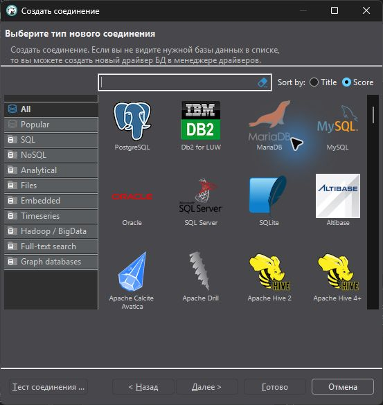
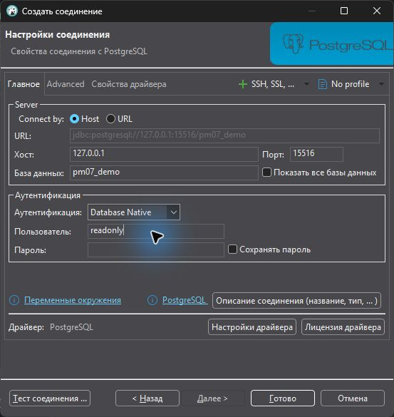
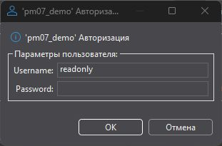
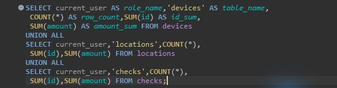
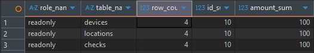

# Выберите один маршрут

## До первого действия

Найдите свой номер в отдельном списке областей. Сопоставьте **оба** значения: СУБД и ОС. Команды другого маршрута в рабочую последовательность не добавляются. Ubuntu Server и Debian используют Linux-маршрут соответствующей СУБД; версия сервера должна совпадать с карточкой.

| Маршрут | Когда использовать | Первое действие |
| --- | --- | --- |
| [MySQL 8 · Linux](../routes/mysql-linux.md) | Варианты 01, 02, 03, 11, 12, 15, 26, 30 | Откройте этот маршрут и заполните его исходные параметры. |
| [MariaDB 10 · Linux](../routes/maria-linux.md) | Варианты 04, 05, 06, 13, 17, 24, 29 | Откройте этот маршрут и заполните его исходные параметры. |
| [PostgreSQL 15/16 · Linux](../routes/pg-linux.md) | Варианты 07, 08, 09, 10, 14, 16, 25, 27 | Откройте этот маршрут и заполните его исходные параметры. |
| [SQL Server Express · Windows](../routes/mssql-windows.md) | Варианты 18, 19, 20, 21, 28 | Откройте этот маршрут и заполните его исходные параметры. |
| [MySQL 8 · Windows](../routes/mysql-windows.md) | Варианты 22 | Откройте этот маршрут и заполните его исходные параметры. |
| [PostgreSQL 16 · Windows](../routes/pg-windows.md) | Варианты 23 | Откройте этот маршрут и заполните его исходные параметры. |

## Правило выбора

Не выбирайте СУБД по знакомому названию команды. Например, `mariadb-dump` относится к MariaDB, а `pg_restore` — к архивам PostgreSQL. SQL Server Express использует Планировщик заданий Windows; SQL Server Agent для этого маршрута не требуется.

## С чего начать в своём проекте

Создайте рабочую папку, указанную в маршруте, и сохраните в ней SQL своего варианта. Имена базы, пользователей, таблиц и файлов в готовых командах сначала заменяются по таблице подстановок. Если команда ещё содержит `NN` или примерное имя базы, выполнять её рано. Точные действия, ожидаемые результаты и объяснения ошибок находятся внутри выбранного маршрута.

## Подключение в DBeaver: разбор на образце

### Выберите свой драйвер

На снимках показан PostgreSQL и учебная база pm07_demo. Сначала «База данных» → «Новое соединение» либо Ctrl+Shift+N. Выберите PostgreSQL, MySQL, MariaDB или SQL Server **по своей карточке**, затем «Далее». Драйвер PostgreSQL не подходит для MySQL, даже если имя базы одинаковое.

### Перепишите параметры из паспорта

В примере сервер доступен с хоста по 127.0.0.1:15516. У себя перепишите адрес и порт именно клиентского подключения, имя своей базы и readonly. Отключите «Сохранять пароль», затем нажмите «Тест соединения». Названия полей могут быть на русском или английском языке.

### Введите пароль в отдельном окне

Если сохранение отключено, поле Password основной формы недоступно. Введите пароль readonly в появившемся окне авторизации. При запросе Download driver используйте заранее подготовленный преподавателем клиент. Успешный тест должен сообщить об установленном соединении; затем «Готово». При первом открытии консоли пароль может запрашиваться снова: это не ошибка входа.

### Откройте консоль и выполните запрос

Выделите своё соединение слева. В меню «Редактор SQL» выберите «Open SQL console», либо нажмите Ctrl+Alt+Enter. Вставьте контрольный SELECT своего маршрута; Ctrl+Enter выполняет текущий запрос. В примере три SELECT объединены UNION ALL, чтобы одновременно видеть все предметные таблицы.

### Сопоставьте результат с CLI

Внизу появляются строки результата, а не только текст запроса. В образце у каждой таблицы 4 строки, сумма id 10, сумма amount 100; роль readonly. У себя должны совпасть имена и значения своего SQL-файла. Пустая таблица результатов, запрос к чужой базе или ошибка входа не подтверждают выполнение.

