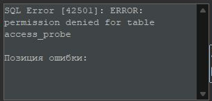

# Пользователи и проверка прав

## Кто управляет чем

| Учётная запись | Разрешено | Не входит в её работу |
| --- | --- | --- |
| Начальный администратор сервера | Создать базу, учётные записи и выдать права | Использовать его вместо всех проверяемых ролей |
| admin | Создавать и удалять учебные таблицы, работать с данными своей базы, делать её копию | Создавать серверные учётные записи на основании только прав на одну базу |
| app_user | SELECT, INSERT, UPDATE и DELETE в выданных таблицах | Создавать таблицы и серверные учётные записи |
| readonly | SELECT | Изменять данные и структуру |

## Как выполнять проверку

Используйте [свой маршрут](stage1.md): там приведён синтаксис именно своей СУБД. Каждая роль проверяется новым подключением. Начальный администратор не используется для действий, которые должен выполнить `app_user` или `readonly`.

Сначала выполните разрешённый SELECT, затем предусмотренный запрет. Ошибка авторизации при входе означает, что роль ещё не проверена. Ошибка SQL-синтаксиса тоже не является доказательством запрета. В журнал переписывается название отклонённой операции и понятная причина отказа.

## Что сравнивать

Видимость служебных баз и схем у разных СУБД различается. Сам список имён не доказывает возможность изменения данных. Проверяются конкретные права и конкретные операции в своей учебной базе. В выводе отчёта не заменяйте это утверждением «ничего лишнего не видно».

## Пример ожидаемого отказа

### Проверяйте причину сообщения

После успешного SELECT в том же соединении readonly выполните отдельно `INSERT INTO access_probe VALUES (2, 20);`. В PostgreSQL ожидается SQLSTATE 42501 и `permission denied for table access_probe`, как на реальном снимке. В других СУБД формулировка и код отличаются; сравнивайте причину, указанную в своём маршруте. Соединение уже установлено, поэтому этот отказ подтверждает запрет записи. Затем отдельно проверьте DELETE и запреты app_user; один снимок INSERT их не заменяет.

