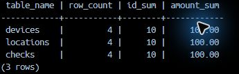
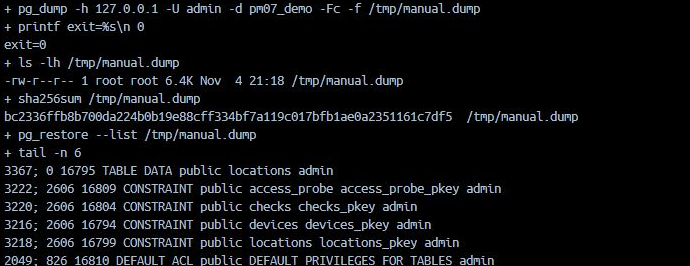
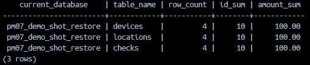

# Резервная копия и восстановление

## До копирования

Сохраните контрольные значения своей базы: по каждой выданной таблице `COUNT(*)`, `SUM(id)` и `SUM(amount)`. В исходном наборе каждая из трёх предметных таблиц содержит 4 строки, сумму id 10 и сумму amount 100. Таблица `access_probe` проверяется отдельно. Если собственная операция меняла данные, зафиксируйте новые значения перед резервированием.

## Какую базу восстанавливать

Восстановление первого бэкапа выполняется в новую `pm07_vNN_restore`. Исходную `pm07_vNN` не удаляют и не переводят в SINGLE_USER ради этой проверки. Точное имя файла берётся из только что выполненной команды; звёздочка в имени не выбирает нужную копию за студента.

## Как понять результат

Последовательность команд находится в [маршруте своей СУБД](stage1.md). После восстановления сравните все таблицы и контрольные значения. Совпадение числа строк при разных суммах или отсутствующей таблице не является совпадением данных.

`pg_restore --list`, `RESTORE VERIFYONLY`, ненулевой размер файла и успешный код команды дают частичные сведения. Итоговая проверка этой практики включает восстановление и запросы к новой базе. SHA-256 подтверждает неизменность конкретного файла между двумя измерениями.

## Если значения различаются

Сначала сопоставьте имена исходной/проверочной базы, точное имя и время создания файла, список включённых таблиц и сообщения команды восстановления. Остановитесь на первой причине. Различие не доказывает автоматически, что «копии делаются слишком редко».

## Разбор восстановления PostgreSQL на образце

### Сначала зафиксируйте данные

Реальный запрос CLI к pm07_demo вернул по 4 строки, сумму id 10 и сумму amount 100. В графическом клиенте получены те же значения. В SQL своего варианта имена таблиц заменяются до запуска; сравнивайте все три, а не одну удобную таблицу.

### Создайте архив и запишите точный файл

Ниже показан результат действительного pg_dump с форматом -Fc, затем размер, SHA-256 и фрагмент списка архива. Здесь файл находится в /tmp/manual.dump; у себя используйте каталог своего маршрута. Строки с «+» показывают выполняемые команды оболочки и не входят в текст, который нужно копировать. Код 0 означает завершение команды, но ещё не проверку восстановления.

### Сверьте отдельную восстановленную базу

Архив восстановлен в заранее выделенную пустую pm07_demo_shot_restore. Это отдельное имя проверочной базы; исходная pm07_demo сохранена. Запрос выполняется уже к назначению и возвращает те же три результата 4/10/100. У себя используйте имя _restore из таблицы подстановок. Синтаксис восстановления для MySQL, MariaDB и SQL Server берётся из своего маршрута, а не из этого примера PostgreSQL.

