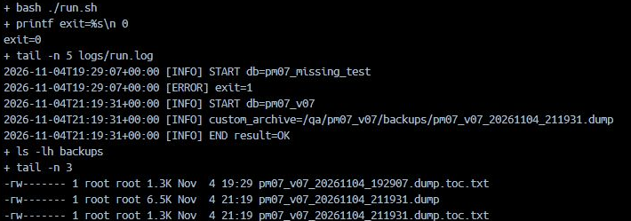
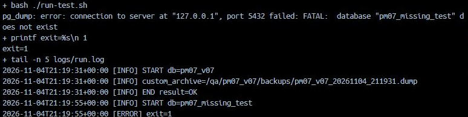
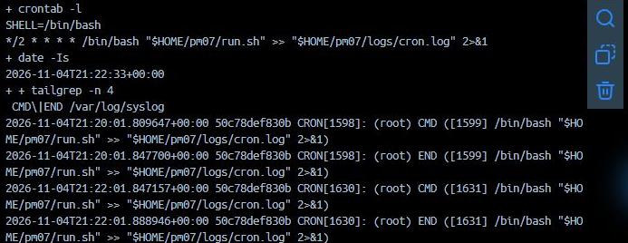
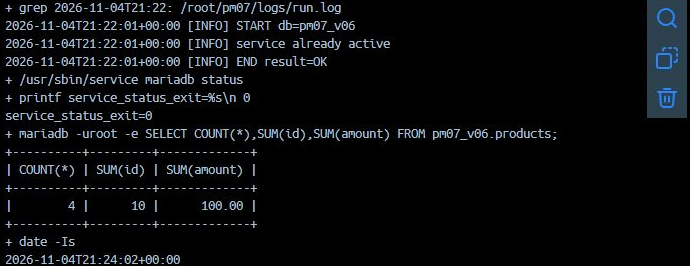
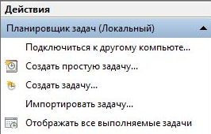

# Одна операция и расписание

## Что автоматизировать

Ручная резервная копия обязательна для всех, а операция по расписанию определяется карточкой варианта. Это может быть бэкап, отчёт, проверка места, обслуживание или другая указанная операция. Не сдавайте ежедневный бэкап вместо отчёта по своему варианту.

## Как устроен скрипт

В [своём маршруте](stage1.md) возьмите каркас Bash или PowerShell, а из карточки — содержимое `run_task` / `Invoke-Task`. Вставка заменяет указанную функцию целиком; параметры и служебные функции берутся из того же маршрута. Названия переменных в карточке и каркасе должны совпадать.

Скрипт фиксирует начало, результат операции, конец и код возврата. Пароль хранится в профиле клиента вне скрипта. Начальный каталог, пользователь ОС и доступ к файлам должны совпадать при ручном и запланированном запуске. Профиль одного пользователя Windows нельзя считать автоматически доступным SYSTEM.

## Сначала вручную

Подготовьте вход для проверки из своей карточки и запустите скрипт. Сверьте код 0, свежую строку END и результат из карточки. Например, для сжатия архивов нужен хотя бы один исходный файл. Сохраните доказательства успешного запуска до отрицательного опыта. Для проверки отказа выберите условие по следующей таблице и используйте отдельную копию.

| Операция | Как вызвать отказ |
| --- | --- |
| Читает или меняет БД | В тестовой конфигурации укажите `pm07_missing_test` вместо имени рабочей базы. |
| Проверяет место, сжимает архивы, запускает службу или читает журнал, варианты 02, 05, 06, 17 | Выполните опыт из своей карточки. Эти операции не проверяют существование базы. |

### Копия для опыта на Linux

В рабочей папке выполните `cp -- run.sh run-test.sh` и `cp -- config.env config-test.env`. В `nano run-test.sh` найдите строку `source "$WORK/config.env"` и замените в ней имя файла на `config-test.env`. Измените условие из таблицы в `config-test.env` либо в тестовой функции, если карточка указывает на функцию. Выполните `bash ./run-test.sh`, сразу после него `echo $?`, затем `tail -n 8 logs/run.log`. Ожидаются ненулевой код и свежая строка ERROR. Для варианта 05 используйте отдельную папку по карточке вместо этой пары файлов.

### Копия для опыта на Windows

В PowerShell в рабочей папке выполните `Copy-Item -LiteralPath run.ps1 -Destination run-test.ps1` и `Copy-Item -LiteralPath config.ps1 -Destination config-test.ps1`. Откройте `notepad.exe run-test.ps1`. В строке `. (Join-Path $Work 'config.ps1')` замените только имя файла на `config-test.ps1`. Откройте тестовую конфигурацию, поставьте в `$Database` значение `pm07_missing_test` и сохраните. Выполните `powershell.exe -NoProfile -File .\run-test.ps1`, сразу после него `$LASTEXITCODE`, затем `Get-Content -LiteralPath .\logs\run.log -Tail 8`.

Сопоставьте причину ошибки с изменённым условием. Запишите код и строку ERROR в раздел отчёта об отказе. Для следующего рабочего опыта запускайте исходный `run.sh` или `run.ps1` с исходным конфигом.

## Индивидуальное дополнение

Выберите одно содержательное дополнение из списка областей. Базовые ERROR/INFO, отсутствие пароля в скрипте и проверка кода обязательны для всех; их наличие само по себе не является новым дополнением. Покажите, что именно добавлено относительно взятого образца и каким отдельным опытом это проверено.

### Образец на Bash: измерьте длительность

В своей рабочей папке сначала скопируйте `run.sh` в `run-timer.sh`. Откройте копию командой `nano run-timer.sh`. Внизу найдите отдельную строку вызова `run_task` между записями START и END. Замените только эту строку следующим блоком. Определение `run_task() { ... }` в середине файла сохраняется.

```bash
started_ms="$(date +%s%3N)"
run_task
finished_ms="$(date +%s%3N)"
log INFO "elapsed_ms=$((finished_ms - started_ms))"
```

Перед запуском проверьте вход. Если операция меняет данные, используйте восстановленную проверочную базу в тестовой конфигурации. Если операция удаляет или переносит файлы, подготовьте новую копию входных файлов. Выполните `bash ./run-timer.sh`, `echo $?` и `tail -n 8 logs/run.log`. При успехе между START и END появится строка `elapsed_ms=...` с числом миллисекунд. Для контрольного опыта можно добавить `sleep 1` сразу после первой строки блока. При успешной операции замер должен быть не меньше 1000 мс. Уберите паузу перед переносом блока в рабочий `run.sh`.

### Образец на PowerShell: измерьте длительность

Выполните `Copy-Item -LiteralPath run.ps1 -Destination run-timer.ps1`, затем `notepad.exe run-timer.ps1`. В блоке `try` найдите отдельную строку `Invoke-Task` между START и END. Вместо неё вставьте следующий блок.

```powershell
$Timer = [System.Diagnostics.Stopwatch]::StartNew()
Invoke-Task
$Timer.Stop()
Write-Log INFO "elapsed_ms=$($Timer.ElapsedMilliseconds)"
```

Для операции, меняющей данные или файлы, сначала выберите проверочную базу либо подготовьте копию файлов. Запустите `powershell.exe -NoProfile -File .\run-timer.ps1`, проверьте `$LASTEXITCODE` и последние строки `logs\run.log`. Для контрольного опыта в копии можно добавить `Start-Sleep -Seconds 1` после первой строки блока. После проверки уберите паузу и перенесите проверенный блок в рабочий `run.ps1`.

### Перенесите приём на свой вариант

Если ваша операция уже пишет длительность, выберите другой пункт из списка дополнений. В отчёте укажите имя файла, место правки и фактический результат отдельного опыта. Для операции, которая меняет данные или удаляет файлы, проверьте дополнение на отдельной копии входных данных. Перед расписанием выполните итоговый рабочий скрипт вручную.

## Затем по расписанию

Используйте ту же учётную запись ОС, что прошла ручную проверку. На Windows задайте ближайший однократный триггер. На Linux добавьте временную строку cron из своего маршрута, дождитесь первого срабатывания и затем замените её постоянной. Сопоставьте время планировщика, новую запись в журнале, код и фактический результат. Если периодичность в карточке не указана, выберите её и объясните в отчёте.

## Подготовьте репозиторий и сдайте отчёт

### Отберите файлы для преподавателя

На своём компьютере создайте отдельную папку для передачи. Положите туда исходный `input.sql`, SQL настройки прав с учебными обозначениями вместо паролей, итоговый `run.sh` или `run.ps1`, пример конфигурации с пустыми секретами и `README.md`. Добавьте требуемые для повторения несекретные входные данные, протокол проверок и экспорт расписания, если они используются. Журнал, резервную копию и доказательства сохраните для сдачи по условиям карточки. Пароли, токены, парольный профиль из папки `auth` и личные данные исключите из файлов для репозитория. Входные скрипты откройте в редакторе и проверьте их содержимое до загрузки.

Если работа находится на учебной машине, откройте выданную общую папку на учебной машине и скопируйте в неё отобранные файлы. Затем откройте ту же папку на своём компьютере и перенесите файлы в папку передачи. При работе только с буфером обмена откройте каждый текстовый файл на учебной машине, скопируйте его целиком и сохраните на своём компьютере под тем же именем. Для резервной копии и снимков используйте выданный канал передачи файлов. Откройте перенесённые скрипт, SQL и журнал на своём компьютере перед загрузкой.

Создайте `README.md` в текстовом редакторе. Укажите номер и область, ОС и СУБД, назначение файлов, какой конфиг создать из примера, команду ручного запуска, периодичность, расположение журнала и ожидаемый результат. Сохраните файл в UTF-8 с расширением `.md`.

### Загрузите файлы через браузер

1. Войдите в GitHub. В меню `+` справа вверху нажмите `New repository`. В поле имени введите, например, `pm07-v05`, подставив свой номер. Выберите видимость по указанию преподавателя, включите создание README и нажмите `Create repository`.
2. На странице своего репозитория откройте `Add file → Upload files` и загрузите SQL, скрипт и остальные подготовленные файлы. Сохраните изменения кнопкой `Commit changes`. Для `README.md` откройте уже созданный файл, нажмите значок карандаша, вставьте свой текст и сохраните изменения. В личном учебном репозитории сохраните работу в основной ветке, чтобы файлы открывались по ссылке на главную страницу.
3. Откройте главную страницу репозитория и проверьте, что видны `README.md`, ваш скрипт и SQL нужного варианта. Откройте по одному файлу каждого типа. Скопируйте адрес главной страницы из строки браузера, например `https://github.com/USERNAME/pm07-v05`. В отчёте замените пример своей ссылкой.

### Проверьте доступ и передайте результат

Публичный репозиторий откройте по скопированной ссылке в приватном окне браузера. Для приватного репозитория предоставьте доступ учётной записи преподавателя по выданной инструкции. Если используется личный GitHub, в своём репозитории откройте `Settings → Collaborators → Add people`, найдите точный логин преподавателя и проверьте, что приглашение принято. До принятия приглашения проверяющий может получить ошибку 404. В учебной организации используйте выданный способ доступа.

Откройте «Отчёт о выполнении проекта.docx» из ZIP своей группы. В разделе «Итоговая проверка и сдача» вставьте адрес в поле ссылки на репозиторий. В Word можно выделить адрес и нажать Ctrl+K, чтобы сделать его ссылкой. Сохраните DOCX и откройте ссылку из сохранённого файла.

### Прикрепите комплект в личном кабинете

Сверьте срок и состав комплекта по «Пояснительной записке к комплекту отчётной документации» из ZIP своей группы. Перенесите итоги и доказательства в презентацию «Приложение 1 к индивидуальному заданию». В PowerPoint для Windows выберите «Файл → Экспорт → Создать документ PDF/XPS» и откройте сохранённый PDF. Проверьте, что в нём читаются результаты.

В личном кабинете откройте задание по учебной практике ПМ.07 своей группы. В поле «Ответ» прикрепите подписанное индивидуальное задание в PDF, презентацию в PDF, «Отчёт о выполнении проекта.docx» и аттестационный лист в DOCX. В аттестационном листе заполните только первый абзац по пояснительной записке. Если в вашей выдаче указаны дополнительные формы, используйте их по той же записке. После отправки убедитесь, что в ответе видны прикреплённые файлы и у каждого правильное расширение.

## Как читать фактические результаты

### Успех ручной операции

В примере варианта 07 выполнен bash ./run.sh: код 0, новая START, путь созданного custom-архива и END result=OK. Журнал хранит историю, поэтому более ранний ERROR остаётся видимым выше. Сопоставляйте время **своего нового запуска**, точное имя базы и существование результата. У другого варианта результат может быть CSV, отчётом или состоянием службы, а не архивом.



### Отказ проверочной копии

В отдельном config-test.env указана pm07_missing_test. Запущен run-test.sh. pg_dump сообщает об отсутствующей базе, код равен 1, последняя запись журнала — ERROR exit=1. Для варианта 02, 05, 06 или 17 выберите отказ из своей карточки.



### Действительный запуск cron

В реальном примере варианта 06 crontab -l содержит один запуск по чётным минутам. В системном журнале есть CMD и END в 21:22 UTC; «+00:00» — часовой пояс записи. При сравнении с локальным временем учитывайте пояс своего паспорта. Этот снимок сделан после наступления времени, без нажатия ручного запуска.



### Подтвердите действие после триггера

За те же 21:22 UTC в журнале скрипта появились START, service already active и END result=OK. Проверка состояния службы вернула код 0, запрос к products — 4/10/100. Если служба уже работает, её повторный запуск не требуется. Отдельный обязательный опыт варианта 06 включает также запуск остановленной учебной службы; одна эта картинка его не заменяет. Парольный профиль в снимки не входит.



## Расписание в Windows

### Откройте создание задачи

Запустите «Планировщик задач» через Пуск. На начальном экране справа выберите «Создать задачу…». Это вход в форму с вкладками «Общие», «Триггеры» и «Действия». Заполняйте их по таблице своего Windows-маршрута. «Создать простую задачу…» открывает другой мастер, поэтому названия следующих шагов в нём отличаются.



### Сопоставьте три поля действия

Программа содержит только путь к powershell.exe; аргументы — -NoProfile -File и полный путь к своему run.ps1; рабочая папка — каталог этого скрипта без имени файла. На вкладке «Общие» оставьте свою проверенную учётную запись Windows и запуск для вошедшего пользователя. На вкладке «Триггеры» создайте один ближайший однократный запуск. Точное заполнение приведено в своём маршруте; значения из Linux-cron сюда не переносятся.

### Проверьте наступивший запуск

После назначенного времени откройте «Библиотека планировщика задач» слева, выберите своё имя PM07_VNN и обновите список клавишей F5. Сопоставьте «Время прошлого запуска» и «Результат последнего запуска» с новой записью START/END своего журнала и фактическим файлом или результатом. При необходимости запросите те же данные из PowerShell:

```powershell
Get-ScheduledTaskInfo -TaskName 'PM07_VNN' |
    Select-Object LastRunTime,LastTaskResult,NextRunTime
```

Замените NN номером своей задачи. LastTaskResult=0 означает успешное завершение процесса; дополнительно проверьте результат операции. Общая сводка на начальном экране не заменяет свойства своей задачи, а ручная команда запуска не подтверждает наступление триггера. После опыта измените существующий триггер на постоянную периодичность своей карточки и экспортируйте XML через правую панель выбранной задачи.
