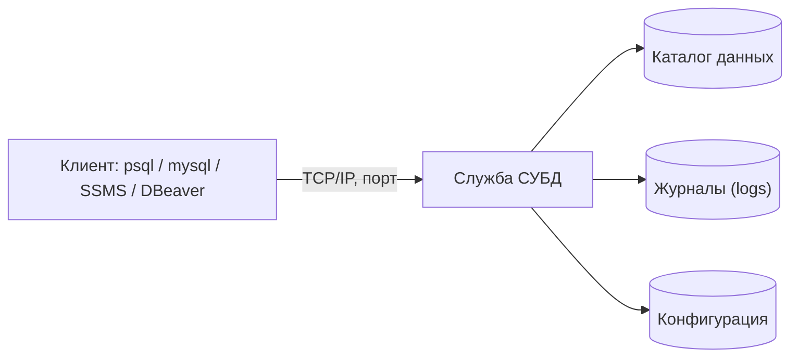

# Этап 1. СУБД, сервер и подключение клиентов

## Что такое СУБД-сервер

Сервер баз данных — программа, которая принимает запросы по сети и работает с файлами хранения данных. У сервера есть три отдельные части:

| Часть | Назначение |
|-------|------------|
| Служба (демон) | Постоянно работающий процесс: `mysqld`, `postgres`, `sqlservr` |
| Каталог данных | Папка с файлами таблиц и журналами (`/var/lib/mysql`, `/var/lib/postgresql/16/main`) |
| Конфигурационный файл | Текст с параметрами: `my.cnf`, `postgresql.conf`, `sqlservr` через реестр и `mssql.conf` |

Администратор отвечает за то, чтобы служба работала, каталог данных был доступен и защищён, а конфигурация соответствовала задаче.

## Клиент-серверная схема



Клиент подключается **по сети**, даже если он находится на том же компьютере. Это значит, что у сервера есть **порт** (`3306`, `5432`, `1433`) и **адрес** (`127.0.0.1`, `0.0.0.0`, конкретный IP), а у клиента — логин и пароль.

## Куда ставить СУБД

В учебной практике сервер ставится в **виртуальную машину** (VirtualBox или VMware). У такого способа три преимущества:

- ошибки не задевают рабочую систему студента;
- виртуалку можно «откатить» к снимку;
- одна и та же команда работает у всех студентов одинаково.

Сетевой режим виртуальной машины — **NAT с пробросом порта** или **Bridged**. Для проброса порта в VirtualBox: `Settings → Network → Advanced → Port Forwarding → Host 13306 → Guest 3306`.

## Минимальные требования к VM

| Параметр | Значение |
|----------|----------|
| CPU | 2 ядра |
| RAM | 2 ГБ (для MS SQL — 3 ГБ) |
| Диск | 20 ГБ динамический |
| ОС | Ubuntu Server 22.04 / Debian 12 / Windows Server 2019/2022 |
| Сеть | NAT + port forwarding или Bridged |

## Установка MySQL/MariaDB на Linux (общий вид)

Команды описывают **принцип**: обновить пакеты, установить, проверить статус, защитить.

```bash
sudo apt update
sudo apt install -y mysql-server     # или: mariadb-server
sudo systemctl status mysql
sudo mysql_secure_installation
```

`mysql_secure_installation` задаёт пароль `root`, удаляет анонимных пользователей и тестовую базу.

## Установка PostgreSQL на Linux

```bash
sudo apt update
sudo apt install -y postgresql postgresql-contrib
sudo systemctl status postgresql
sudo -u postgres psql -c "\du"   # список ролей
```

В PostgreSQL по умолчанию работает только локальный пользователь `postgres` через socket. Для входа по логину/паролю редактируется файл `pg_hba.conf`.

## Установка MS SQL Server Express на Windows Server

1. Скачать установщик MS SQL Server Express.
2. Запустить «Basic» установку.
3. Установить SSMS (SQL Server Management Studio) или Azure Data Studio.
4. Включить TCP/IP в **SQL Server Configuration Manager**: SQL Server Network Configuration → Protocols → TCP/IP → Enabled.
5. Перезапустить службу `SQL Server (SQLEXPRESS)`.

## Конфигурационный файл

Главные параметры, которые администратор настраивает на первом шаге:

| Параметр | MySQL/MariaDB (`my.cnf`) | PostgreSQL (`postgresql.conf`) | MS SQL |
|----------|--------------------------|--------------------------------|--------|
| Порт | `port = 3306` | `port = 5432` | SQL Server Configuration Manager → IPAll → TCP Port |
| Адрес | `bind-address = 127.0.0.1` | `listen_addresses = 'localhost'` | Network Configuration → TCP/IP |
| Каталог данных | `datadir = /var/lib/mysql` | `data_directory = '/var/lib/postgresql/16/main'` | задаётся при установке |
| Кодировка | `character-set-server = utf8mb4` | `client_encoding = 'UTF8'` | Collation при создании БД |
| Журнал ошибок | `log_error = /var/log/mysql/error.log` | `log_directory = 'log'` | `ERRORLOG` |

После изменения конфига службу нужно перезапустить:

```bash
sudo systemctl restart mysql        # или: mariadb / postgresql
```

## Управление службой

| Операция | Linux (systemctl) | Windows (PowerShell) |
|----------|-------------------|----------------------|
| Запустить | `sudo systemctl start mysql` | `Start-Service "MSSQL`$SQLEXPRESS"` |
| Остановить | `sudo systemctl stop mysql` | `Stop-Service "MSSQL`$SQLEXPRESS"` |
| Перезапустить | `sudo systemctl restart mysql` | `Restart-Service "MSSQL`$SQLEXPRESS"` |
| Статус | `sudo systemctl status mysql` | `Get-Service` |
| Автозапуск | `sudo systemctl enable mysql` | `Set-Service -Name "..." -StartupType Automatic` |

## Проверка доступности порта

После запуска службы важно проверить, что **порт открыт** и **процесс его слушает**.

```bash
# Linux
sudo ss -tlnp | grep -E '3306|5432'

# Windows (PowerShell)
Get-NetTCPConnection -LocalPort 1433 | Format-Table -Auto
```

С хоста проверка идёт через `telnet`, `nc` или встроенный `Test-NetConnection`:

```powershell
Test-NetConnection -ComputerName 192.168.56.10 -Port 3306
```

## Консольные клиенты

| СУБД | Клиент | Подключение |
|------|--------|-------------|
| MySQL/MariaDB | `mysql` | `mysql -h 127.0.0.1 -P 3306 -u root -p` |
| PostgreSQL | `psql` | `psql -h 127.0.0.1 -p 5432 -U postgres -d postgres` |
| MS SQL | `sqlcmd` | `sqlcmd -S 127.0.0.1\SQLEXPRESS -E` (Windows Auth) |

## GUI-клиенты

Можно использовать любой кросс-СУБД клиент:

- **DBeaver Community** — единый клиент для MySQL, MariaDB, PostgreSQL, MS SQL;
- **MySQL Workbench** — только MySQL/MariaDB;
- **pgAdmin** — только PostgreSQL;
- **SQL Server Management Studio (SSMS)** — только MS SQL.

GUI удобен для просмотра данных и составления запросов; командная строка — для скриптов автоматизации.

## Журналы сервера

Все события администратор находит в **журналах**.

| СУБД | Журнал ошибок |
|------|---------------|
| MySQL | `/var/log/mysql/error.log` |
| MariaDB | `/var/log/mysql/error.log` |
| PostgreSQL | `/var/log/postgresql/postgresql-16-main.log` |
| MS SQL | `Program Files\Microsoft SQL Server\MSSQL15.SQLEXPRESS\MSSQL\Log\ERRORLOG` |

Привычка администратора: **смотрит журнал каждый раз, когда что-то не работает**. Сообщение в журнале точнее, чем сообщение клиенту.

## Типичные ошибки на этом этапе

- порт занят другой службой → сменить порт в конфиге или остановить мешающую службу;
- служба не стартует из-за прав на каталог данных → исправить владельца (`chown -R mysql:mysql /var/lib/mysql`);
- клиент с хоста не подключается → не настроен проброс порта или `bind-address = 127.0.0.1`;
- пустой пароль `root` → запустить `mysql_secure_installation`.

## Артефакты этапа

К концу этапа должны быть собраны:

- скриншот команды статуса службы (`active (running)` / `Running`);
- скриншот успешного входа клиентом CLI и клиентом GUI;
- путь и фрагмент конфигурационного файла;
- путь и три последние строки журнала ошибок;
- информационная справка: имя, версия СУБД, версия ОС, IP-адрес VM, порт.
